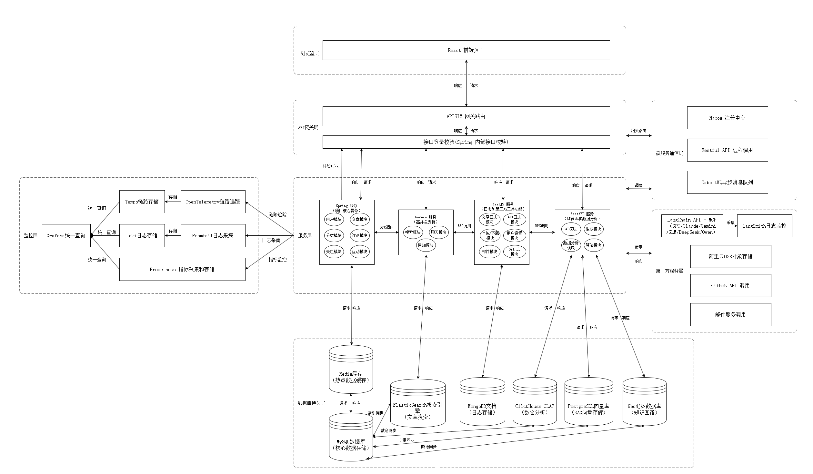
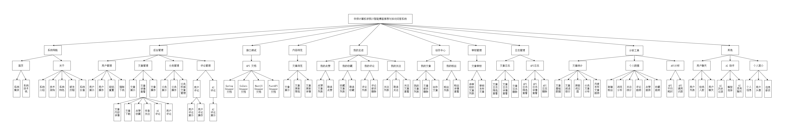
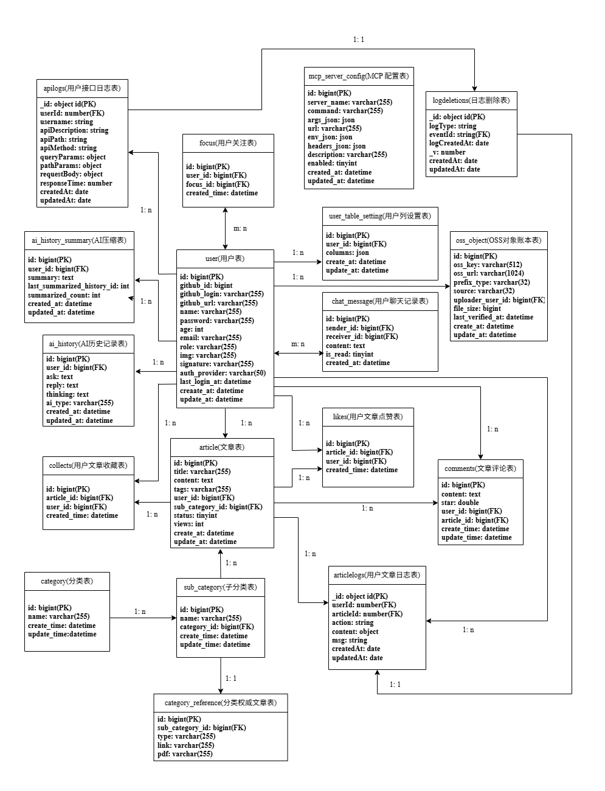
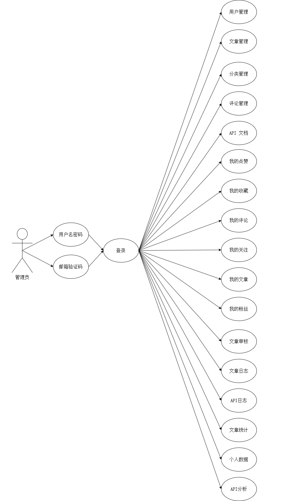
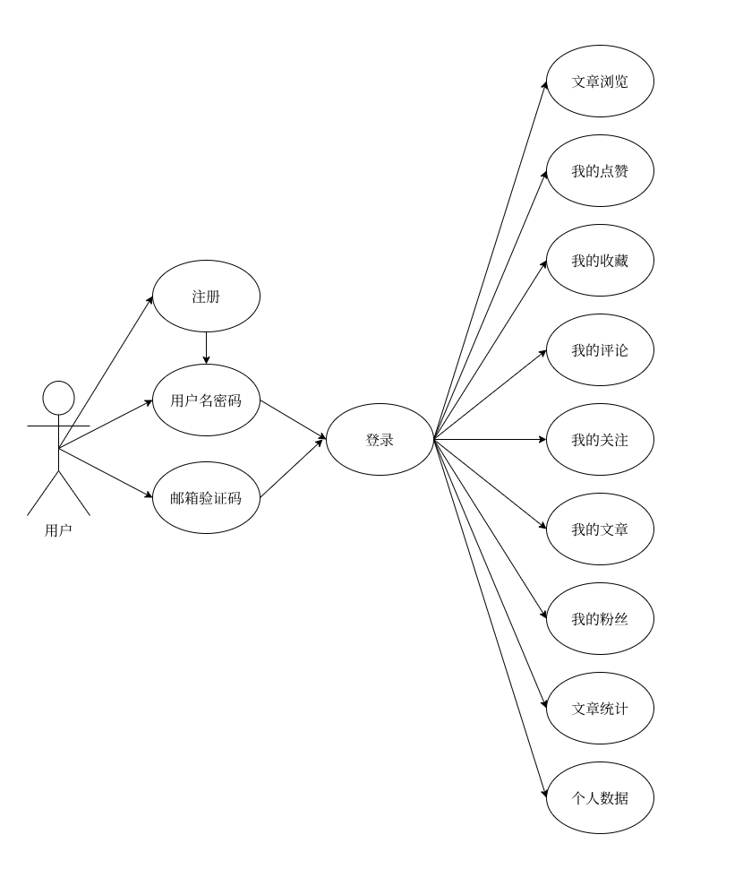

# 项目结构与流程说明

本文档说明项目的整体分层结构、核心数据关系与主要业务流程，配套设计图统一存放在 `docs/diagrams/`（drawio 导出的 PNG）。

根目录 `README.md` 的「设计图」章节用 mermaid 源码维护同一批图的正文版本，便于随代码 review 差异；本文档侧重说明每张图表达什么、在什么场景下使用，便于在 Apifox 等不渲染 mermaid 的环境中查阅。

> 仓库内没有保留 `.drawio` 源文件，PNG 无法再编辑。修改设计图时请同时更新根目录 `README.md` 对应章节的 mermaid 源码，避免两处内容分叉。

## 整体结构

### 系统架构图

按调用方向自上而下分为七层：

| 层次         | 内容                                                                                                                                                                                    |
| ------------ | --------------------------------------------------------------------------------------------------------------------------------------------------------------------------------------- |
| 浏览器层     | React 前端页面                                                                                                                                                                          |
| 应用网关层   | APISIX 网关路由与端口资源校验（调用 Spring 内部接口完成鉴权）                                                                                                                           |
| 服务治理层   | Nacos 注册中心、Restful API 远程调用、RabbitMQ 异步消息队列                                                                                                                             |
| 服务层       | Spring（用户/文章/分类/评论/关注/互动）、GoZero（搜索/聊天/通知）、NestJS（文章日志/API 日志/上传下载/用户设置/邮件/GitHub）、FastAPI（AI/生成/数据分析/算法）                            |
| 第三方服务层 | LLM（LangChain API + MCP）、LangSmith 日志监控、阿里云 OSS、GitHub API、邮件服务                                                                                                        |
| 监控层       | OpenTelemetry、Tempo、Promtail、Loki、Prometheus、Grafana                                                                                                                                 |
| 数据持久层   | MySQL（核心数据）、Redis（热点缓存）、ElasticSearch（文章搜索）、MongoDB（日志）、ClickHouse（OLAP 分析）、PostgreSQL 向量库（RAG 向量）、Neo4j（知识图谱）                              |

图中另外标注了服务之间的 RPC 调用链（Spring ↔ GoZero ↔ NestJS ↔ FastAPI），以及 MySQL 向 ES、ClickHouse、Postgres、Neo4j 的数据同步关系。

### 项目功能结构图

按前端功能模块自顶向下展开：系统导航、用户管理、后台管理、接口测试、内容浏览、我的足迹、创作中心、审核管理、日志管理、分析工具，一级模块下再列出具体页面与功能点。

用于判断某个页面或功能由哪个服务提供，以及新增功能应该挂在哪个模块下。

## 数据关系

### ER 图

以 `USER` 与 `ARTICLE` 两张核心表为中心：用户创建文章，并产生点赞、收藏、评论、关注与操作日志；`APILOGS`、`USER_TABLE_SETTING`、`OSS_OBJECT`、`AI_HISTORY`、`AI_HISTORY_SUMMARY`、`CHAT_MESSAGE` 等支撑表挂在用户下。

新增表或调整外键前，先用这张图确认既有关系，避免字段归属错位；表结构定义仍以 `db/` 下的 SQL 初始化脚本为准。

## 角色与用例

### 管理员用例图

管理员视角：通过用户名密码或邮箱验证码登录后，可执行用户管理、文章管理、分类管理、评论管理、文章审核；查看 API 文档、文章日志、API 日志、文章统计、个人数据、API 分析；管理自己的点赞、收藏、评论、关注、文章与粉丝。

### 用户用例图

普通用户视角：支持注册、用户名密码登录、邮箱验证码登录；登录后可使用文章浏览，以及我的点赞、我的收藏、我的评论、我的关注、我的文章、我的粉丝、文章统计、个人数据。
